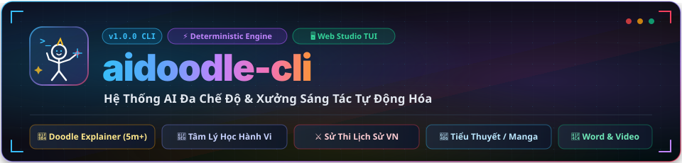

<p align="center">
  
</p>

<p align="center">
  <a href="https://github.com/vinh-gogo/aidoodle-cli/releases"></a>
  
  
  
  
  
  
</p>

<p align="center">
  <strong>Bộ công cụ dòng lệnh (CLI) và Dashboard Web tự động hóa quy trình sáng tác nội dung chuyên sâu bằng 100% Tiếng Việt.</strong><br>
  Hỗ trợ toàn diện <strong>7 Chế độ sáng tác chuyên biệt</strong>: từ kịch bản video viral <strong>Doodle Explainer</strong> (Người Que đồ đá), video <strong>Tâm lý học hành vi</strong> chuẩn khoa học não bộ, đến tiểu thuyết trường thiên <strong>Lịch sử Việt Nam</strong>, <strong>Trinh thám & Kinh dị</strong> (Fair-Play 3:2), <strong>Ngôn tình & Chữa lành</strong> (Lie/Ghost/Need), <strong>Kỳ ảo & Tiên hiệp</strong> (Quy tắc cứng Sanderson) và <strong>Tiểu thuyết / Manga</strong> kỳ ảo đa tầng.
</p>

---

## 🌟 Điểm Nổi Bật Vượt Trội

- 🎯 **7 Chế độ làm việc AI chuyên biệt (`/mode` 1–7)**: Phân tách độc lập 100% kho tài nguyên prompt, voice, style, reference và cơ chế kiểm soát chất lượng (Gated mechanical validators); chuyển đổi tức thì trong TUI hoặc Web UI.
- 🌐 **Web UI Dashboard Phong Cách Retro Terminal (`ainovel-cli web`)**:
  - Giao diện SPA 3 panel hiện đại, theo dõi luồng viết trực tiếp qua Server-Sent Events (SSE) thời gian thực kèm chỉ báo tự động kết nối lại khi mất mạng.
  - Bảo mật cao cấp: mặc định bind địa chỉ an toàn `127.0.0.1`, hỗ trợ token xác thực (`--token`), phòng vệ tấn công Origin/CSRF (`Sec-Fetch-Site`), ngăn chặn Path Traversal và lọc khử độc XSS cho nội dung Markdown.
  - Hệ thống thông báo Toast phi phong tỏa (thay thế toàn bộ hộp thoại `alert` chặn luồng).
- 📚 **Trình Xuất Bản Sách W3C EPUB 3.3 Thuần Go (Zero Dependency)**:
  - Tuân thủ nghiêm ngặt chuẩn W3C EPUB 3.3 và EPUB Accessibility 1.1 bằng Go chuẩn (không cần cài thêm Java hay thư viện ngoài).
  - Đóng gói OCF Container chuẩn xác (mimetype `zip.Store` uncompressed ở Entry 0), OPF 3.0 Dublin Core metadata, tài liệu điều hướng `nav.xhtml` lồng phân cấp **Quyển (Volume) $\rightarrow$ Hồi (Arc) $\rightarrow$ Chương (Chapter)** cùng `<nav epub:type="landmarks">`.
  - Chuẩn hóa Unicode NFC (`norm.NFC`), lọc sạch 100% ký tự điều khiển cấm trong XML 1.0 (`0x00`–`0x1F`), an toàn tuyệt đối trên mọi thiết bị đọc sách (Apple Books, Calibre, Kindle, Kobo, Thorium).
- 📄 **Xuất File Microsoft Word (.docx) Native**: Tạo tệp Office OpenXML (.docx) chuẩn in ấn: trang bìa tiêu đề sách, ngắt trang trang trọng, phân cấp Heading 1, thụt đầu dòng 0.5 inch, phông chữ Times New Roman 13pt thoáng đãng.
- ⚙️ **Deterministic Engine & Checkpoint Saga**: Tầng sự thật xác định điều phối 3 tác tử (**Architect / Writer / Editor**) cùng trọng tài ngữ nghĩa (**Arbiter**). Lưu vết trạng thái từng bước (Step-level atomic IO), tự động phục hồi khi ngắt điện ngang.
- 🔬 **Bộ Kiểm Tra Cơ Học Đầu Ra (Mechanical Output Validators)**:
  - Tự động chặn và loại bỏ ký tự CJK (chữ Hán, tiếng Nhật, tiếng Hàn) trong văn xuôi tiếng Việt.
  - Kiểm soát độ dài nghiêm ngặt: 2.000–4.500 từ/chương đối với 5 thể loại tiểu thuyết; 700–1.500 từ LỜI (300–600s) đối với 2 thể loại video.
  - Tự động phát hiện vòng lặp câu/đoạn, phát hiện kết thúc cụt giữa câu, lọc danh sách từ cấm convert Hán-Việt và ngăn chặn rò rỉ thẻ video (`HOOK`, `LỜI:`, `HÌNH:`) vào tiểu thuyết.
- 📦 **Xuất Trọn Gói Kịch Bản Video TikTok/Shorts (`/export --video`)**: Kết xuất đồng bộ `scripts/` (kịch bản chuẩn), `voiceover/` (lời đọc sạch cho thu âm/TTS), `shotlist.csv` (bảng phân cảnh kèm UTF-8 BOM cho Excel) và `publish.csv` (tiêu đề, caption, hashtag, nguồn).

---

## 📑 Mục Lục

1. [7 Chế Độ Sáng Tác AI Chuyên Biệt (/mode)](#7-chế-độ-sáng-tác-ai-chuyên-biệt-mode)
2. [Cài Đặt & Khởi Động Nhanh Trong 60 Giây](#cài-đặt--khởi-động-nhanh-trong-60-giây)
3. [Hướng Dẫn Web UI Dashboard (ainovel-cli web)](#hướng-dẫn-web-ui-dashboard-ainovel-cli-web)
4. [Xuất Bản Đa Định Dạng (W3C EPUB 3.3, Word DOCX, Video)](#xuất-bản-đa-định-dạng-w3c-epub-33-word-docx-video)
5. [Cấu Hình & Kết Nối Mô Hình AI (LLM Gateway)](#cấu-hình--kết-nối-mô-hình-ai-llm-gateway)
6. [Bảng Tra Cứu Lệnh TUI & CLI](#bảng-tra-cứu-lệnh-tui--cli)
7. [Hỏi Đáp & Xử Lý Sự Cố (FAQ) — Sửa Lỗi Font PowerShell](#hỏi-đáp--xử-lý-sự-cố-faq--sửa-lỗi-font-powershell)
8. [Giấy Phép & Đóng Góp](#giấy-phép--đóng-góp)

---

## 🎭 7 Chế Độ Sáng Tác AI Chuyên Biệt (/mode)

Khi nhập lệnh `/mode` trong TUI hoặc bấm nút chọn mode trên Web UI, bạn có thể chuyển đổi tức thì giữa 7 phong cách nghiệp vụ:

| Phím | Chế độ Canonical | Định dạng | Quy cách & Trọng tâm nghiệp vụ |
| :---: | :--- | :--- | :--- |
| **`1`** | **Tiểu thuyết / Manga**<br>`novel-manga` | Tiểu thuyết văn xuôi | 2.000 – 4.000 từ/chương, cấu trúc phân tầng Volume $\rightarrow$ Arc $\rightarrow$ Chapter, thế giới quan đa tầng, chiều sâu nội tâm nhân vật, không rò rỉ thẻ kịch bản video. |
| **`2`** | **Trinh thám & Kinh dị**<br>`suspense` | Tiểu thuyết trinh thám / ly kỳ | 2.500 – 4.500 từ/chương. **Luật chơi công bằng Fair-Play 3:2** (3 manh mối thật, 2 manh mối giả/red herring), Ma trận Chân tướng Kép, suy luận logic nghiêm ngặt, Đồng hồ Đếm ngược Sinh tử, cấm deus ex machina. |
| **`3`** | **Ngôn tình & Chữa lành**<br>`romance` | Tiểu thuyết tình cảm / chữa lành | 2.500 – 4.000 từ/chương. **Hồ sơ Vết thương Tâm lý (Lie/Ghost/Need)**, Thang đo Cảm xúc 6 Cấp độ chuyển biến tự nhiên, Đối thoại giàu ẩn ý (Subtext), xóa bỏ 100% sáo ngữ tổng tài áp đặt. |
| **`4`** | **Kỳ ảo & Tiên hiệp**<br>`fantasy` | Tiểu thuyết tiên hiệp / kỳ ảo | 2.500 – 4.500 từ/chương. **Hệ thống ma thuật quy tắc cứng (3 Định luật Sanderson)**, Bản đồ Thế giới Đa tầng, Trận chiến chiến thuật 3 pha, bộ lọc sạch từ ngữ dịch máy convert Hán-Việt. |
| **`5`** | **Tiểu thuyết Lịch sử Việt Nam**<br>`vietnamese-history` | Tiểu thuyết dã sử / sử thi | 2.000 – 4.000 từ/chương. Tôn chỉ *"Đúng đủ để người đọc tin, sống đủ để người đọc quan tâm"*. **Bảng bất biến lịch sử**, Bảng vùng tự do, Xung đột kép (đời tư va đập thời cuộc), xưng hô Đại Việt chuẩn thời, kèm mục **Hậu ký và Ghi chú lịch sử tác giả**. |
| **`6`** | **Doodle Explainer**<br>`doodle-explainer` | Kịch bản video người que | 5–8 phút (700–1.500 từ LỜI, 300–600s), nhịp 1:1 Thoại - Hình xen kẽ liên tục (đổi nét vẽ mỗi 3–6s), cấu trúc 5 giai đoạn, Tái Hook mỗi 60–90s, dí dỏm viral TikTok/Shorts. |
| **`7`** | **Tâm lý học hành vi**<br>`behavioral-psychology` | Kịch bản video tâm lý | 5–8 phút, chuẩn mực **Khung khoa học não bộ 8 bước**. Phân biệt rạch ròi tương quan vs nhân quả, cảnh báo mẫu WEIRD & khủng hoảng tái lập, Cú hích hành vi (Nudge), rào chắn đạo đức **tuyệt đối không chẩn đoán y tế**. |

---

## ⚡ Cài Đặt & Khởi Động Nhanh Trong 60 Giây

### Cách 1: Tải Bản Cài Đặt Biên Dịch Sẵn (Khuyến nghị cho Windows)
1. Tải bản phát hành mới nhất từ [Releases](https://github.com/vinh-gogo/aidoodle-cli/releases) (`ainovel-cli-windows-amd64.zip` hoặc file `.exe`).
2. Giải nén vào một thư mục làm việc (ví dụ `D:\ainovel-cli`).
3. Mở PowerShell trong thư mục đó và khởi động:
   ```powershell
   .\ainovel-cli.exe
   ```

### Cách 2: Biên Dịch Từ Mã Nguồn (Dành cho nhà phát triển)
Yêu cầu Go phiên bản 1.25 trở lên:
```bash
git clone https://github.com/voocel/ainovel-cli.git
cd ainovel-cli
go build -trimpath -o ainovel-cli.exe ./cmd/ainovel-cli
.\ainovel-cli.exe --version
```

---

## 🌐 Hướng Dẫn Web UI Dashboard (`ainovel-cli web`)

Trải nghiệm sáng tác trên giao diện trình duyệt Web hiện đại (Desktop, Tablet, Mobile) với đầy đủ các biện pháp gia cố an ninh mạng:

```powershell
# Khởi chạy trên cổng 8080 (mặc định bind an toàn 127.0.0.1)
.\ainovel-cli.exe web 8080

# Mở giao diện cho mạng nội bộ/LAN kèm Token xác thực bảo vệ
.\ainovel-cli.exe web 8080 --external --token "bi-mat-cua-ban"
```

Mở trình duyệt truy cập: **`http://localhost:8080`** (hoặc URL kèm `?token=...` nếu bật auth).

### Các tính năng cốt lõi trên Web UI:
- **Panel 1 (Cột Trái)**: Bộ chọn 7 Chế độ AI (`/mode`), cây thư mục các chương và danh sách toàn bộ tác phẩm trong `output/` với Tag Mode trực quan.
- **Panel 2 (Cột Giữa)**: Trình xem luồng viết trực tiếp (Live Streaming Markdown) theo thời gian thực và chế độ đọc sách ban đêm (Reader view).
- **Panel 3 (Cột Phải)**: Bảng Event Logs trực quan hiển thị từng bước ra quyết định của Arbiter, truy vấn tìm kiếm Tavily và tiến độ của Writer/Editor.
- **Thanh Điều Khiển Dưới**: Nhập ý tưởng sáng tác, gửi chỉ đạo can thiệp (Steer), nút xuất nhanh EPUB / Word và điều khiển tạm dừng/tiếp tục.
- **An Toàn Tuyệt Đối**: Chống tấn công CSRF, chống Path Traversal đọc trộm file ngoài `output/`, lọc sạch mã độc XSS và hiển thị thông báo Toast không gây gián đoạn công việc.

---

## 📚 Xuất Bản Đa Định Dạng (W3C EPUB 3.3, Word DOCX, Video)

Sau khi hoàn thành tác phẩm, bạn có thể xuất bản tác phẩm sang nhiều định dạng chuyên nghiệp:

### 1. Xuất Sách Điện Tử Chuẩn W3C EPUB 3.3
```powershell
# Xuất EPUB bằng lệnh CLI
.\ainovel-cli.exe --dir output/novel-20261017-1500 --epub

# Hoặc gõ lệnh trong TUI console
/export --epub
```
- Tệp `.epub` được sinh ra đạt chuẩn **W3C EPUB 3.3** và **EPUB Accessibility 1.1**:
  - Entry đầu tiên là `mimetype` lưu trữ không nén (`zip.Store`).
  - Mục lục phân cấp đa tầng trong `nav.xhtml` (Quyển $\rightarrow$ Hồi $\rightarrow$ Chương).
  - Tự động chuẩn hóa Unicode NFC tiếng Việt, lọc sạch ký tự điều khiển cấm trong XML 1.0.
  - Tương thích 100% với Calibre, Apple Books, Kobo, Kindle Previewer.

### 2. Xuất Tài Liệu Microsoft Word OpenXML (.docx)
```powershell
# Xuất file Word qua TUI
/export --word    # hoặc /export --docx
```
- Định dạng chuẩn bản in chuyên nghiệp: Phông chữ Times New Roman 13pt, thụt đầu dòng 0.5 inch, ngắt trang giữa các chương, tiêu đề Heading 1 trang trọng.

### 3. Xuất Gói Sản Xuất Video TikTok / YouTube Shorts
```powershell
# Dành cho 2 mode video (doodle-explainer & behavioral-psychology)
/export --video
```
- Tạo trọn bộ 4 thư mục/tệp bàn giao:
  - `scripts/`: Toàn bộ kịch bản hoàn chỉnh định dạng Markdown.
  - `voiceover/`: Lời đọc sạch 100% (bóc tách thẻ hình ảnh) phục vụ thu âm hoặc Voice AI (TTS).
  - `shotlist.csv`: Bảng phân cảnh chi tiết có gắn UTF-8 BOM, mở bằng Microsoft Excel hiển thị tiếng Việt hoàn hảo.
  - `publish.csv`: Bảng dữ liệu đăng bài gồm Tiêu đề, Caption, Hashtags và Nguồn tham khảo.

---

## ⚙️ Cấu Hình & Kết Nối Mô Hình AI (LLM Gateway)

Hệ thống hỗ trợ mọi LLM tương thích chuẩn OpenAI API (OpenAI, OpenRouter, DeepSeek, vLLM, Ollama, Llama.cpp):

Tạo hoặc chỉnh sửa tệp `.ainovel/config.json` (hoặc cấu hình toàn cục `~/.ainovel/config.json`):

```jsonc
{
  "provider": "openai",
  "model": "main-llm",
  "context_window": 32768,
  "providers": {
    "openai": {
      "type": "openai",
      "api_key": "YOUR_GATEWAY_API_KEY",
      "base_url": "https://api.gloryvocab.com/v1",
      "models": [
        {
          "name": "main-llm",
          "context_window": 32768
        }
      ]
    }
  },
  "roles": {
    "architect": { "provider": "openai", "model": "main-llm" },
    "writer":    { "provider": "openai", "model": "main-llm" },
    "editor":    { "provider": "openai", "model": "main-llm" }
  }
}
```

> [!TIP]
> **Khuyến nghị kích thước ngữ cảnh**: Đặt `context_window: 32768` ở cấu hình client, và khởi động `llama-server` trên backend với `--ctx-size 65536`. Điều này cung cấp 32K token vùng đệm an toàn cho KV Cache và lượt suy luận dài, triệt tiêu 100% lỗi tràn context.

---

## ⌨️ Bảng Tra Cứu Lệnh TUI & CLI

| Lệnh TUI | Phím tắt / Tham số | Mô tả chức năng |
|---|---|---|
| `/mode` | `/topic` (Phím `1`–`7`) | Mở bảng chuyển đổi giữa 7 chế độ sáng tác AI chuyên biệt |
| `/dash` | `/dashboard`, `/projects` | Mở Dashboard quản lý toàn bộ tác phẩm trong `output/` kèm Tag Mode |
| `/new` | — | Khởi tạo phiên sáng tác mới sạch trong thư mục timestamp riêng |
| `/review` | `on` / `off` | Bật / tắt cổng duyệt người (Human-in-the-loop Gate) sau mỗi chương |
| `/next` | — | Cấp phép sản xuất chương tiếp theo khi đang ở chế độ duyệt |
| `/export` | `--epub`, `--word`, `--video` | Xuất bản tác phẩm sang EPUB 3.3, Word DOCX hoặc gói video TikTok |
| `/diag` | — | Chạy chẩn đoán toàn diện về tiến độ, cấu trúc và chất lượng nội dung |
| `/status` | — | Hiển thị tiến độ hoàn thành, số từ và chi phí ước tính |
| `/config` | — | Xem và điều chỉnh nhà cung cấp LLM, API Key, Base URL |
| `/model` | — | Đổi nhanh mô hình LLM hoặc mức độ tư duy (Reasoning Effort) |
| `/sync` | — | Đồng bộ các chỉnh sửa thủ công từ file `.md` vào bộ nhớ Store |
| *(Gõ tự do)* | Steer | Can thiệp chỉ đạo ý kiến trực tiếp vào thanh lệnh để AI điều chỉnh cốt truyện |

---

## ❓ Hỏi Đáp & Xử Lý Sự Cố (FAQ) — Sửa Lỗi Font PowerShell

### 1. Tại sao chữ tiếng Việt hiển thị trên PowerShell bị lỗi font (Mojibake)?
Đây là hiện tượng mã hóa mặc định của Windows PowerShell (sử dụng Code Page 437 hoặc 1252), **không phải lỗi hỏng file hay lỗi phần mềm**. Toàn bộ dữ liệu của `ainovel-cli` được lưu chuẩn UTF-8.

Để hiển thị tiếng Việt có dấu sắc nét 100% trên Windows PowerShell, hãy chạy lệnh sau trước khi dùng:

```powershell
[Console]::OutputEncoding = [System.Text.Encoding]::UTF8
$OutputEncoding = [System.Text.Encoding]::UTF8
chcp 65001
```

> [!NOTE]
> Để áp dụng vĩnh viễn cho mọi phiên PowerShell, bạn có thể thêm dòng lệnh trên vào tệp cấu hình profile của PowerShell (`$PROFILE`).

### 2. Làm thế nào khi bị báo lỗi "thư mục output đang bị khóa bởi tiến trình khác (.ainovel.lock)"?
Khi phiên làm việc trước bị tắt ngang (đóng terminal đột ngột), file khóa an toàn `.ainovel.lock` có thể chưa kịp giải phóng.
Xử lý bằng cách xóa file khóa còn sót:

```powershell
# Trên Windows PowerShell:
Remove-Item -Path "output/novel-YYYYMMDD-HHMM/.ainovel.lock" -Force

# Trên Linux / macOS:
rm -f output/novel-YYYYMMDD-HHMM/.ainovel.lock
```

### 3. Quy trình chi tiết khi gặp lỗi chương treo hoặc mất mạng?
Vui lòng tham khảo tài liệu vận hành chi tiết tại: **[`docs/runbook.md`](docs/runbook.md)** để biết quy trình từng bước phục hồi sau sự cố bằng Saga Checkpoint.

---

## 📄 Giấy Phép & Đóng Góp

- Dự án được phát hành theo giấy phép mã nguồn mở **[MIT License](LICENSE)**.
- Kế thừa và phát triển từ nền tảng kiến trúc Deterministic Engine của dự án gốc [ainovel-cli](https://github.com/voocel/ainovel-cli) bởi tác giả [voocel](https://github.com/voocel) và cộng đồng sáng tạo [linux.do](https://linux.do/).
- Bản quyền nâng cấp thuộc về cộng đồng sáng tạo nội dung Tiếng Việt. Chúc bạn tạo nên những tác phẩm tuyệt vời! 🇻🇳
