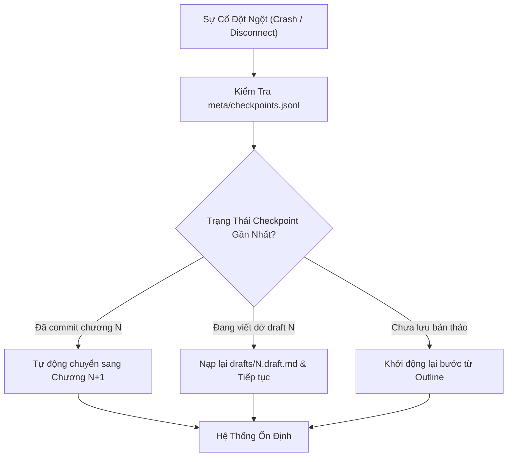

# Cẩm Nang Vận Hành & Khắc Phục Sự Cố (Operational Runbook)

_Tài liệu hướng dẫn quy trình vận hành, giám sát và xử lý sự cố thực chiến cho hệ thống `ainovel-cli` (`aidoodle-cli`)._

---

## 1. Tổng Quan Kiến Trúc Độ Tin Cậy (Reliability Architecture)

`ainovel-cli` được thiết kế theo nguyên tắc: **Tầng sự thật xác định, Tầng ngữ nghĩa tự chủ** (*Fact layer deterministic, Semantic layer autonomous*).
- **Trạng thái bền vững (State Persistence)**: Từng bước làm việc được lưu vết tức thì qua `Store` với cơ chế ghi tệp nguyên tử (Atomic IO: `CreateTemp` $\rightarrow$ `Write` $\rightarrow$ `Sync` $\rightarrow$ `Rename`).
- **Saga Checkpoint**: Mọi tiến trình chuyển đổi giai đoạn (`Outline`, `Plan`, `Draft`, `ConsistencyCheck`, `Commit`) đều tạo bản ghi trong `meta/checkpoints.jsonl`.
- **Khóa độc quyền thư mục (`.ainovel.lock`)**: Ngăn chặn 2 phiên chạy cùng lúc ghi đè làm hỏng dữ liệu tác phẩm.
- **Rào chắn suy thoái mềm (Graceful Degradation)**: Khi mất mạng hoặc lỗi dịch vụ ngoài (Tavily), hệ thống tự suy thoái mềm thay vì sụp đổ.

---

## 2. Quy Trình Xử Lý Sự Cố Từng Bước (Incident Playbooks)

### 2.1 Sự cố 1: Chương treo / Luồng SSE đứng im (Hanging Chapter / Stream Stuck)

#### Hiện tượng:
- TUI hoặc Web UI dừng ở trạng thái `[Writing...]` hoặc `[Drafting...]` hơn 5–10 phút mà không có token mới sinh ra.
- Log xuất hiện cảnh báo `stream idle timeout` hoặc không có thêm sự kiện nào trong `meta/sessions/*.jsonl`.

#### Nguyên nhân:
1. LLM server bị nghẽn suy luận (inference queue backlog) do GPU quá tải.
2. Mạng giữa CLI và LLM Gateway bị mất gói tin ngầm (silent TCP drop).
3. Vòng lặp suy nghĩ (reasoning loop) quá sâu đối với các prompt phức tạp.

#### Các bước xử lý:
1. **Kiểm tra tiến trình**:
   - Mở cửa sổ dòng lệnh khác, kiểm tra xem tiến trình `ainovel-cli` có còn tiêu thụ CPU/bộ nhớ không:
     ```powershell
     Get-Process ainovel-cli*
     ```
2. **Dừng an toàn (Graceful Stop)**:
   - Trong TUI: Nhấn `Ctrl + C` một lần để gửi tín hiệu ngắt an toàn. Hệ thống sẽ hoàn tất thao tác IO đang dở dang và giải phóng lock.
   - Trong Web UI: Nhấn nút `Tạm dừng (Pause)` trên thanh công cụ.
3. **Khôi phục tiến trình (Resume)**:
   - Khởi động lại `ainovel-cli` trong cùng thư mục dự án:
     ```powershell
     .\ainovel-cli.exe --dir output/novel-YYYYMMDD-HHMM
     ```
   - Nhờ kiến trúc Saga Checkpoint, engine sẽ tự động kiểm tra bản thảo gần nhất (`drafts/%02d.draft.md`), nhận diện bước chưa hoàn thành và tiếp tục viết tiếp từ điểm dừng mà không bị mất dữ liệu.

---

### 2.2 Sự cố 2: Gateway chết / Mất kết nối LLM (Gateway Disconnection / Death)

#### Hiện tượng:
- Web UI hiển thị thông báo toast: `Mất kết nối với máy chủ AI (SSE Disconnected)`.
- Terminal in lỗi: `dial tcp: connectex: No connection could be made because the target machine actively refused it` hoặc HTTP `502 Bad Gateway` / `504 Gateway Timeout`.
- `~/.ainovel/last-error.log` ghi nhận chuỗi lỗi kết nối liên tiếp.

#### Nguyên nhân:
1. Phiên Google Colab bị ngắt do hết quota thời gian GPU (thường sau 4–12 tiếng).
2. Cloudflare Tunnel ngắt kết nối hoặc URL tunnel bị thay đổi.
3. `llama-server` trên Colab bị crash do Out Of Memory (OOM VRAM).

#### Các bước xử lý:
1. **Kiểm tra trạng thái Colab Gateway**:
   - Truy cập notebook Colab (`kaggle/colab_llama_cpp.ipynb`).
   - Kiểm tra cell chạy Cloudflare Tunnel và `llama-server`. Nếu phiên bị ngắt kết nối (Disconnected), bấm **Runtime $\rightarrow$ Restart session and run all**.
2. **Kiểm tra Pre-flight Health Check**:
   - Dùng lệnh curl hoặc PowerShell kiểm tra endpoint:
     ```powershell
     Invoke-RestMethod -Uri "https://api.gloryvocab.com/v1/models" -Headers @{ Authorization = "Bearer $env:GATEWAY_API_KEY" }
     ```
   - Nếu trả về JSON danh sách model (`main-llm`), gateway đã hồi phục.
3. **Cấu hình Fallback dự phòng**:
   - Nếu Colab không khả dụng, chuyển sang dùng nhà cung cấp dự phòng trong cấu hình `.ainovel/config.json`:
     ```json
     {
       "provider": "openrouter",
       "model": "anthropic/claude-3.5-sonnet",
       "roles": {
         "writer": {
           "provider": "openrouter",
           "model": "anthropic/claude-3.5-sonnet"
         }
       }
     }
     ```
4. **Tiếp tục sáng tác**:
   - Chạy lệnh tiếp tục:
     ```powershell
     .\ainovel-cli.exe --dir output/novel-YYYYMMDD-HHMM
     ```

---

### 2.3 Sự cố 3: Tràn cửa sổ ngữ cảnh (Context Window Exhaustion / HTTP 400)

#### Hiện tượng:
- Giao diện báo lỗi HTTP 400 với thông điệp: `exceed_context_size_error` hoặc `openai: stream ended before [DONE]`.
- Hệ thống lập tức dừng lại, không rơi vào vòng lặp retry vô ích (nhờ cơ chế NonRetryableError).

#### Nguyên nhân:
1. Tổng dung lượng `SystemPrompt + novel_context` vượt quá ranh giới an toàn 60% của cửa sổ 32,768 tokens (hoặc vượt `--ctx-size 65536` trên server).
2. Tài liệu tham khảo hoặc kết quả tra cứu Tavily quá dài tích tụ trong bộ nhớ làm việc.

#### Các bước xử lý:
1. **Kiểm tra kích thước tài liệu dự án**:
   - Chạy công cụ chẩn đoán tích hợp:
     ```powershell
     .\ainovel-cli.exe diag --dir output/novel-YYYYMMDD-HHMM
     ```
   - Báo cáo sẽ chỉ rõ số lượng tokens của từng phần và các cảnh báo bất thường.
2. **Thu gọn bộ nhớ ngữ cảnh**:
   - Engine tự động áp dụng `compactReference` (cắt bỏ phần ví dụ trùng lặp, kẹp trần 900–1.200 runes) và `compactSourcePack` (tối đa 4 bài, kẹp trần 1.200 runes).
   - Nếu người dùng tự cấu hình thêm luật trong `.ainovel/rules/*.md`, hãy kiểm tra và rút gọn các văn bản luật quá dài.
3. **Cấu hình đồng bộ**:
   - Đảm bảo file cấu hình `.ainovel/config.json` đồng nhất:
     ```json
     "context_window": 32768
     ```
   - Đảm bảo tham số khởi động của `llama-server` trên gateway luôn là:
     ```bash
     --ctx-size 65536
     ```
   - Khoảng cách giữa 32K và 65K tạo vùng đệm 32.768 tokens cho KV cache và đầu ra của model, triệt tiêu hoàn toàn nguy cơ tràn ngữ cảnh.

---

### 2.4 Sự cố 4: Xung đột file khóa còn sót (Lock Contention / Stale Lock File)

#### Hiện tượng:
- Khởi động CLI hoặc chạy lệnh xuất bản báo lỗi:
  ```text
  thư mục output đang bị khóa bởi tiến trình khác (.ainovel.lock)
  ```
- Hoặc trên Windows xuất hiện thông báo: `Access is denied (lỗi quyền truy cập file khóa .ainovel.lock)`.

#### Nguyên nhân:
1. Phiên làm việc trước đó bị tắt đột ngột (mất điện, đóng Terminal bằng dấu X đỏ, Task Manager End Task) khiến file khóa chưa kịp xóa.
2. Có một cửa sổ Terminal hoặc phiên bản Web UI khác đang cùng trỏ vào thư mục này.

#### Các bước xử lý:
1. **Xác nhận không còn tiến trình nào đang chạy ngầm**:
   ```powershell
   Get-Process ainovel-cli* | Select-Object Id, ProcessName, Path
   ```
   Nếu có tiến trình cũ bị treo, kết thúc tiến trình:
   ```powershell
   Stop-Process -Name ainovel-cli -Force
   ```
2. **Xóa file khóa còn sót (Stale Lock Removal)**:
   - Trong thư mục dự án:
     ```powershell
     Remove-Item -Path "output/novel-YYYYMMDD-HHMM/.ainovel.lock" -Force
     ```
   - Trên Linux/macOS:
     ```bash
     rm -f output/novel-YYYYMMDD-HHMM/.ainovel.lock
     ```
3. **Khởi động lại**:
   - Hệ thống sẽ tạo lease khóa mới và hoạt động bình thường.

---

### 2.5 Sự cố 5: Lỗi xuất bản tệp EPUB / Word / Video (Export Errors)

#### Hiện tượng:
- Chạy `/export --epub` hoặc `/export --word` báo lỗi: `tệp đích đã tồn tại`, `không tìm thấy chương hoàn thành`, hoặc `lỗi cú pháp XML`.

#### Nguyên nhân:
1. Tệp xuất bản cùng tên đã tồn tại trong thư mục nhưng không truyền cờ `--overwrite`.
2. Dự án chưa có chương nào được commit thành công (chỉ mới dừng ở bản nháp `drafts/`).
3. Nội dung văn bản chứa ký tự điều khiển lạ chưa được lọc sạch.

#### Các bước xử lý:
1. **Xuất đè tệp cũ**:
   - Thêm cờ ghi đè:
     ```text
     /export --epub --overwrite
     /export --word --overwrite
     ```
2. **Kiểm tra tiến độ chương**:
   - Xem trạng thái qua lệnh `/status` hoặc mở file `meta/progress.json`.
   - Nếu chương đang ở dạng nháp trong `drafts/%02d.draft.md`, exporter tự động kích hoạt pipeline fallback. Tuy nhiên, khuyến nghị nên cho AI chạy qua bước commit (`/next`) để đảm bảo chất lượng.
3. **Kiểm tra tính hợp lệ của tệp EPUB 3.3**:
   - Trình xuất bản thuần Go của `ainovel-cli` tự động chuẩn hóa Unicode NFC (`norm.NFC`) và lọc sạch toàn bộ ký tự điều khiển XML cấm (`U+0000`–`U+001F` trừ tab/LF/CR). Tệp `.epub` sinh ra đạt chuẩn W3C và có thể mở tức thì trên Calibre, Apple Books, Kobo, Thorium.

---

### 2.6 Quy Trình Rollback & Resume Tự Động (Rollback & Recovery Workflow)

Khi gặp sự cố nghiêm trọng không thể khắc phục tại chỗ:



1. **Xem nhật ký quyết định (Decision Replay)**:
   - Toàn bộ lý luận của AI được ghi lại trong `meta/decisions.jsonl`. Đọc tệp này để biết bước cuối cùng Agent đang thực hiện là gì:
     ```powershell
     Get-Content "output/novel-YYYYMMDD-HHMM/meta/decisions.jsonl" -Tail 20
     ```
2. **Khôi phục thủ công nếu cần (Manual Rollback)**:
   - Nếu một chương bị viết hỏng hoặc vi phạm quy tắc, mở `meta/progress.json`, chỉnh sửa trường `completed_chapters` lùi lại 1 chương, xóa tệp `chapters/%02d.md` bị lỗi, sau đó khởi chạy lại CLI để AI viết lại chương đó.
